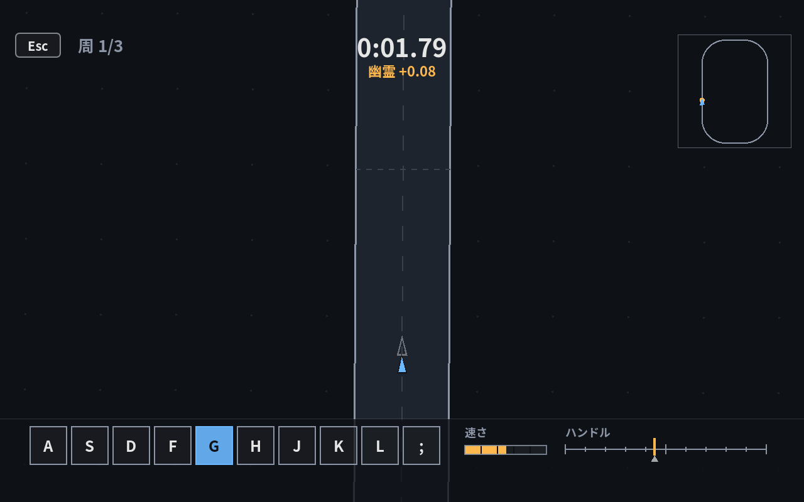
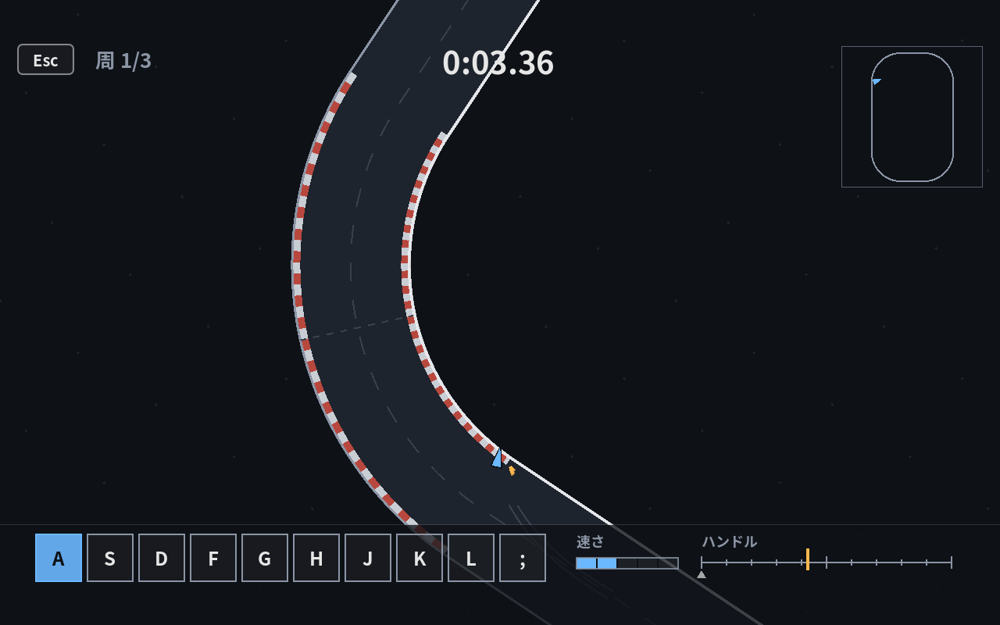
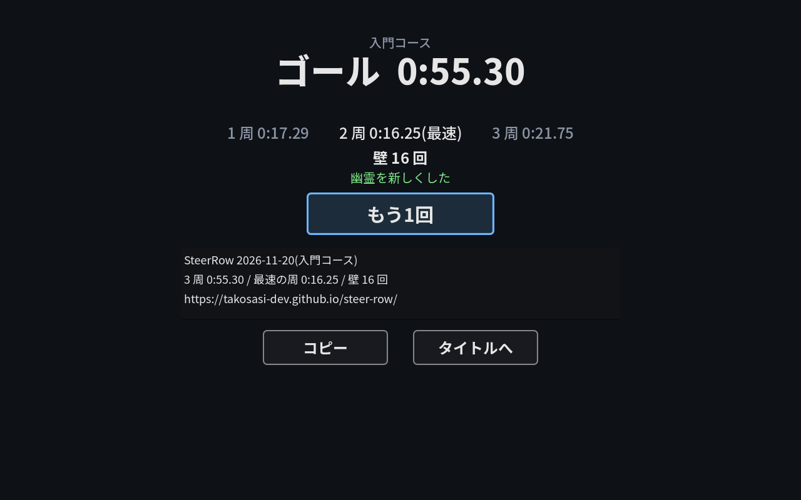

# SteerRow

上から見たタイムアタックのレースです。キーボードの中の段の 10 キー(**A S D F G H J K L ;**)が**ハンドルの角度の目盛り**で、A で左いっぱい、; で右いっぱい、何も押さなければ真っすぐ。隣り合う 2 つを押すと、その間の角度になります。アクセルは自動で、**Space がブレーキ**。3 周のタイムを、前の自分の幽霊と競います。ブラウザで開くだけで遊べます。

**▶ 遊ぶ: https://takosasi-dev.github.io/steer-row/** (デスクトップの Chrome・Edge・Firefox。キーボードで遊びます。インストール不要)







> v0.2.0。人に遊んでもらう確かめはまだです。ハンドルの回る速さ・車の速さ・滑り方は仕様の初期値のままで、人が走って決めた値ではありません。コース 1〜15 は試作で、遊んでから選び直します。

## 遊び方

- 車は勝手に前へ進みます。押しているキーの目盛りの平均へ、ハンドルが決まった速さで回ります。押すキーを横へずらすと、角度を細かく選べます。
- 速いほど小さく回れません。速いまま強く切ると後ろが滑って外へふくらむので、きついカーブの前は Space で減速します。
- 壁に当たると遅くなります(コースの外へは出ません)。
- コースの途中の関門を順に通ってからスタートの線を越えると 1 周。3 周でゴールです。
- 自分の一番速い走りが、線だけの三角(幽霊)になって一緒に走ります。
- 始まりの 3・2・1 の間に押したキーで、ハンドルを先に切っておけます。
- Esc で一時停止。設定で、操作を **W A S D**(A で左いっぱい、D で右いっぱい、S でブレーキ)に替えられます。画面の回転(車が常に上を向く)も切れます。設定の「キーの確かめ」で、同時に押さえたキーが届いているかを見られます。

## 今日のコース

「今日のコース」は日付で決まり、同じ日なら誰でも同じコースです(15 日で一巡)。結果画面の文字をコピーして貼れば比べられます。

```
SteerRow 2026-11-19(今日のコース 8・1回目)
3 周 1:02.35 / 最速の周 0:20.11 / 壁 4 回
https://takosasi-dev.github.io/steer-row/
```

「入門コース」はゆるいカーブだけのコースで、一度走り切るまでタイトルの一番上にあります。「コースを選ぶ」で 16 本から選べます。

## しくみ

- **ゲームの決まりは `core/` にだけ**あります(ハンドル・車の動き・壁・周回・タイム・幽霊)。画面は `sim.snapshot()` と `sim.events()` を読んで描くだけです。Godot の物理エンジンは使っていません。
- 1/120 秒刻みで進め、入力は毎 tick の「10 キーの組(10 ビット)とブレーキ」だけです。向きは長さ 1 のベクトルで持ち、`sin`・`cos` を使わず小さい角度の回転の式で回すので、同じ入力なら同じ走りになります。幽霊は位置ではなく**入力の記録**を同じ計算で再生しています。
- キーは位置(`physical_keycode`)で取るので、JIS 配列でも US 配列でも同じ位置が同じ目盛りです。
- コースは亀の命令(直進・左右の円弧)で書いた `courses/src/*.txt` から `tools/build_courses.py` が作ります。閉じているか・半径・幅・長さ・道が重ならないかを道具が調べます。
- 保存はブラウザの中(localStorage の `steer-row/save`)だけです。サーバーとの通信やアクセス解析はありません。

## 動作環境

- Godot 4.7.2-stable(GDScript、レンダラー Compatibility)
- Web 書き出しはスレッド無し・拡張無し

## 開発

```
# テスト(全件成功で終了コード 0)
godot --headless --import
godot --headless --script res://tests/run_tests.gd

# コースを作る・調べる(Python。--check は調べるだけ)
python tools/build_courses.py
python tools/build_courses.py --check

# Web 書き出し(書き出しテンプレート 4.7.2 が要る)
godot --headless --export-release "Web" build/web/index.html

# 同じことを Python から(GODOT に Godot の場所を入れる)。smoke は本体を窓なしで S0 → 結果まで 2 回通す
python tools/gd.py test
python tools/gd.py export
python tools/gd.py smoke 3000000 --auto
python tools/gd.py smoke-pck      # 書き出した index.pck を本体にして同じことをする

# ブラウザでの確かめ(Node.js と Chrome。窓なし・消音・使い捨てのプロフィールで開き、画面を build/web_shots/ に撮る)
node tests/web/check.mjs
SR_URL=https://takosasi-dev.github.io/steer-row/ node tests/web/check.mjs   # 公開した物を確かめる

# 字体を画面の文字に絞る・効果音を作る(Python)
pip install fonttools
python tools/subset_font.py
python tools/gen_sfx.py
```

`main` に push すると、GitHub Actions がコースの調べ → テスト → Web 書き出し → GitHub Pages への配置を行います(`.github/workflows/pages.yml`)。

## 開発状況

- v0.2.0。テストはヘッドレスの Godot で通っています。テスト用の bot(中心線の少し先へ向かう)が 16 本とも 3 周を壁 0 回で走り切ります。
- 窓なしの Chrome(デスクトップ版の Chrome をヘッドレスで)で、起動から S0 → タイトル → 設定 → キーの確かめ → 入門コース 2 回(本物のキーの押す・離すで走る)→ 一時停止・タブが裏に回った時の一時停止 → 結果 → コピー → コースを選ぶ → W A S D・回転なしで壁に当てる、までを通しています(`tests/web/check.mjs`。キーボードだけで S1 → S6 → S2 も通ります)。保存が `steer-row/save` に入り、開き直しても残り、同じサイトのほかのゲームの保存を消さないこと、読み込みの後 3 分の通信が 0 件なことも見ています。
- R-4(幽霊の再生が Web と headless でずれないか)は判定済みで、当たりませんでした: ブラウザで本物のキーで走った記録(壁 16 回・滑りあり)を、ヘッドレスの Godot で再生した最後の位置と、ブラウザの 2 回目に出た幽霊の最後の位置が、どちらも小数 6 桁まで一致しました(差 0 px)。
- まだ確かめていないこと: Edge・Firefox、本物のキーボードでの同時押さえ(隣り合う 2 キーと Space)、音を耳で聞くこと、画面の回転で酔わないか、人に遊んでもらうこと。
- 撤退基準のうち、R-1(10 キーの方が矢印より気持ちよいか)・R-2(3 周を 5 回続けた後の指の疲れ)・R-3(隣り合う 2 キーと Space が届くか)は、人と本物のキーボードが要るので未判定です。

## ライセンス

MIT(`LICENSE`)。同梱の字体は SIL Open Font License 1.1 です(`THIRD-PARTY-NOTICES.md`)。
